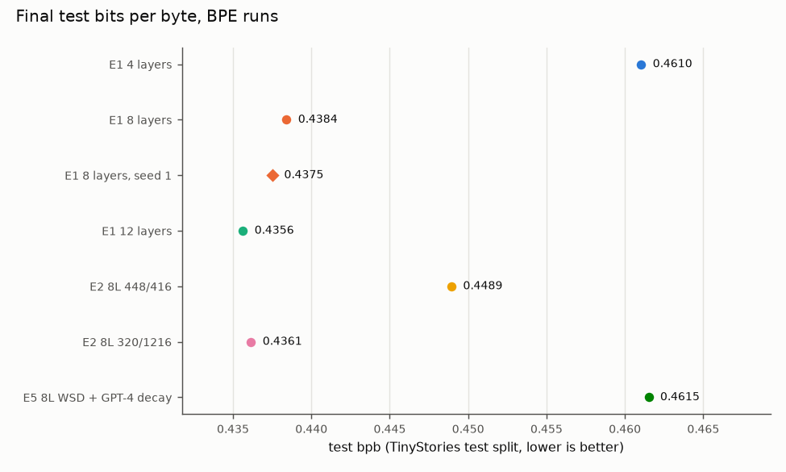
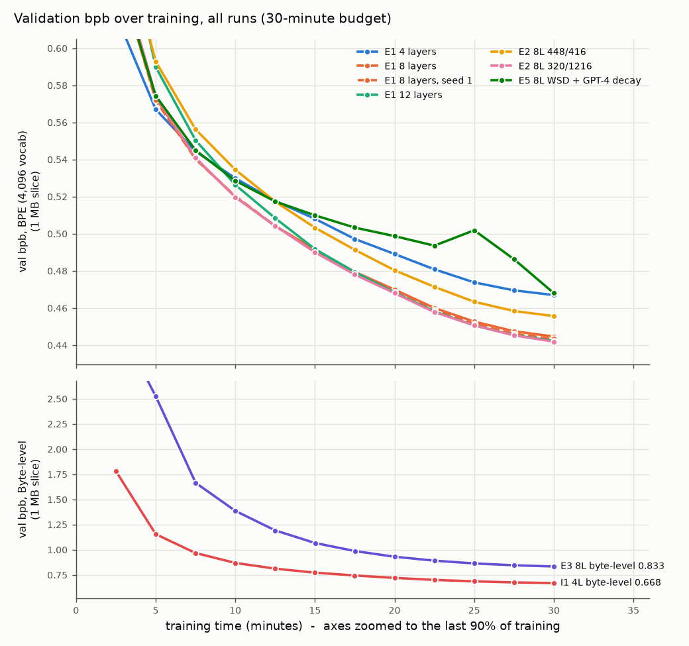
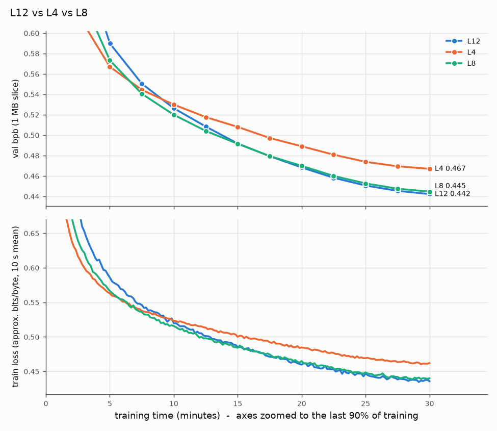
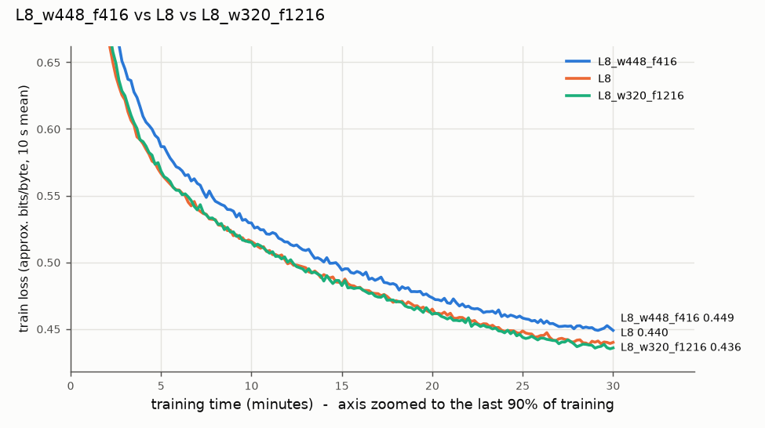
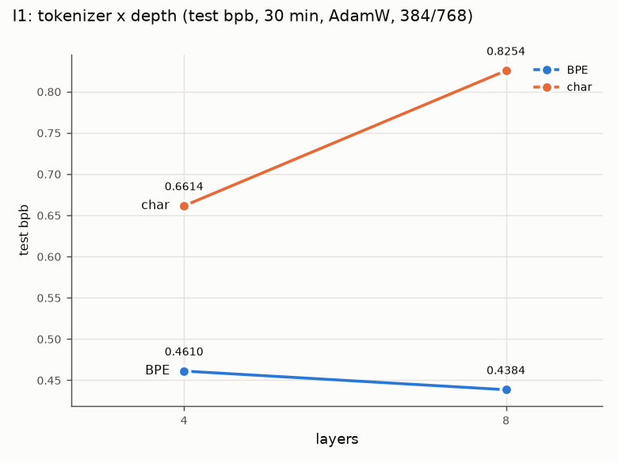
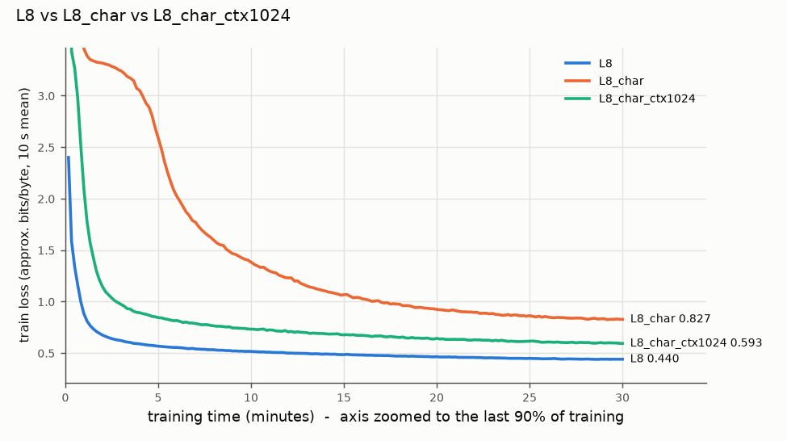
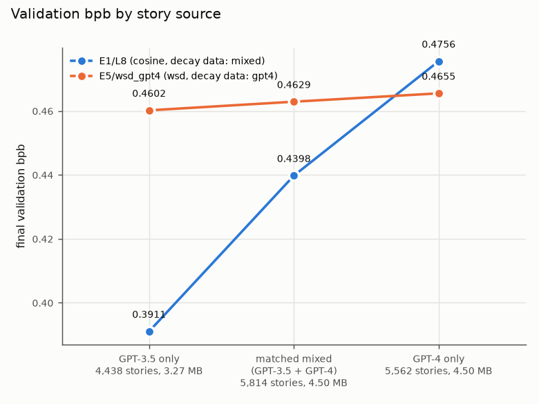
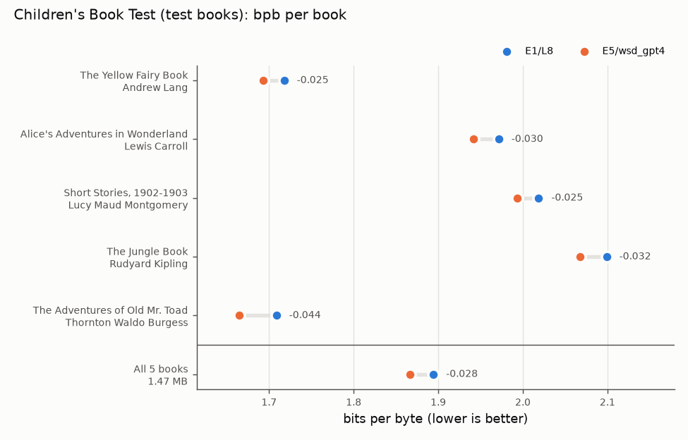

# Small language models under a 30-minute compute budget

DSA4212 project. GPT-style language models are trained **from random initialisation** on
[TinyStories](https://huggingface.co/datasets/roneneldan/TinyStories), and design choices
(depth, width vs FFN size, tokenizer, late-stage data) are compared under a fixed budget of
**30 minutes of training on one RTX 3060 Ti (8 GB)**. Every result is **test bits per byte (bpb)**,
which is comparable across tokenizers.

The experiment design is in [PLAN.md](PLAN.md); the [deviations](#deviations-from-planmd)
from it are listed below.

## Declarations

| Item | Declaration |
| --- | --- |
| Compute budget | 1,800 s of training wall-clock time per run on one NVIDIA RTX 3060 Ti (8 GB), bf16, `torch.compile`. Validation, compile warm-up and final evaluation are excluded (timer paused). ≈ 3.5 × 10¹⁶ training FLOPs for the BPE models at the baseline shape (3.2–4.2 × 10¹⁶ across runs; see `scripts/flops_table.py`). |
| Initialisation | All weights randomly initialised. No pretrained weights, embeddings or tokenizers: both tokenizers are trained here on the training split. |
| Evaluation | Bits per byte on 10,000 held-out TinyStories test stories (same text for every run), evaluated once per final run. Validation is used for every choice. |

Software: Python 3.14.2, PyTorch 2.15.0+cu132 (CUDA 13.2), triton-windows 3.9.0, NVIDIA
driver 610.88, native Windows 11. Every run log records these.

## Results

All runs: pre-norm GPT (RMSNorm, sinusoidal positions, tied embeddings, GELU FFN, 4 heads,
no biases), AdamW (0.9/0.95, weight decay 0.1 on hidden matrices, clip 1.0), 32 sequences per
step, context 1,024 BPE tokens (4,128 bytes for character level), cosine schedule driven by
elapsed time unless stated. Peak learning rate = (range-test rise point) / 3, per configuration.

| Stage | Run | Non-emb. params | LR | Tokens seen | Test bpb |
| --- | --- | --- | --- | --- | --- |
| E1 depth (width 384, FFN 768) | 4 layers | 4.72M | 1.8e-3 | 741M | 0.4610 |
| | **8 layers** (carried forward) | 9.44M | 1.6e-3 | 415M | **0.4384** |
| | 12 layers | 14.17M | 1.3e-3 | 288M | 0.4356 |
| | 8 layers, seed 1 (repeat) | 9.44M | 1.6e-3 | 415M | 0.4375 |
| E2 width / FFN (8 layers, ≈ equal params) | 448 / 416 (0.93×) | 9.41M | 1.4e-3 | 367M | 0.4489 |
| | 384 / 768 (2×) | 9.44M | 1.6e-3 | 415M | 0.4384 |
| | 320 / 1,216 (3.8×) | 9.51M | 1.7e-3 | 396M | 0.4361 |
| E3 tokenizer (8 layers) | byte-level (char), 32 × 4,128 bytes per step | 9.44M | 1.3e-3 | 314M bytes | 0.8254 |
| | byte-level, 32 × 1,024 bytes per step (same tokens per step as BPE) | 9.44M | 1.1e-3 | 449M bytes | 0.5959 |
| I1 tokenizer × depth | char, 4 layers | 4.72M | 2.5e-3 | 619M bytes | 0.6614 |
| E5 staged data (8 layers) | WSD, GPT-4-only stories in the last 20% | 9.44M | 1.6e-3 | 416M | 0.4615 |

**Seed noise.** Repeating the 8-layer run with another seed (initialisation and data order)
changed test bpb by 0.0009. With two seeds this is only indicative; differences below ≈ 0.005 bpb
are treated as ties.

**E5 by story source and out of domain** (validation sets; Children's Book Test = 5 real
Project Gutenberg children's books, 1.47 MB, detokenised, evaluation only):

| Evaluation text | E1 8 layers (cosine, mixed data) | E5 (WSD, GPT-4-only decay) |
| --- | --- | --- |
| GPT-3.5 stories only (3.27 MB) | **0.391** | 0.460 |
| Size-matched mixed (4.50 MB) | **0.440** | 0.463 |
| GPT-4 stories only (4.50 MB) | 0.476 | **0.466** |
| Children's Book Test, all 5 books | 1.894 | **1.867** (better on every book) |

### Main findings

1. **Size:** more parameters help up to about 8 layers, then level off (4 → 8: −0.023 bpb; 8 → 12: −0.003, a tie). Larger models are still improving at the deadline: budget-limited, not converged.
2. **Shape:** at equal parameters, a 2–4× FFN is best; shifting parameters into width is slightly worse (+0.010), partly because it runs slower.
3. **Tokenizer:** BPE beats bytes by a wide margin; the byte model reads ≈ 5× less text in the same time, despite using ≈ 18% more FLOPs. Giving the byte model the same tokens per step as BPE (32 × 1,024 bytes: 5.8× more optimiser steps, ¼ of the context) improves it from 0.825 to 0.596, still 0.158 bpb behind BPE.
4. **Interaction:** depth helps BPE (−0.023) but hurts the byte model (+0.164); interaction +0.187 bpb. A depth chosen for BPE does not transfer to byte-level modelling.
5. **Data:** a GPT-4-only decay specialises the model: better on GPT-4 text, much worse on GPT-3.5 text, worse on the mixed test set, but better on real children's books. Schedule and data are confounded (no WSD-mixed control).

### Figures





Training loss per stage (in approximate bits per byte, comparable across tokenizers), and the
E1–E5 analysis plots:

| | |
| --- | --- |
|  |  |
|  |  |
|  |  |

Every run folder also has `curves.png` (train loss, validation bpb, learning rate over time)
and `log.json` (resolved config, git commit, seed, versions, parameter counts, tokens and
epochs, tokens/s, peak VRAM, validation curve, final validation/test bpb, samples).
Learning-rate range tests are in `runs/lr/`.

## Deviations from PLAN.md

- **E0** (three baseline seeds) replaced by a single repeat of the 8-layer model.
- **E1** run adaptively (8 → 4 → 12 layers); 1 and 2 layers not run. 12 layers tied with 8, so the cheaper 8 was kept.
- **E2** ran two variants (0.93× and 3.8× FFN); the 7× variant was dropped. 3.8× tied with 2×, so 2× was kept.
- **E3** adds a byte-level run with the same tokens per step as BPE (32 × 1,024 bytes) instead of the same bytes per step; its learning rate came from its own range test.
- **I1** compares 4 vs 8 layers instead of 2 vs 8 (reuses E1's 4-layer run).
- **E4** (SGD, Muon) and **I2** not run; optional O1–O3 not run.
- **E5** ran only the GPT-4 arm and is compared with E1's cosine run, so schedule and data are confounded. Added per-source validation sets and the Children's Book Test.
- Learning-rate rule fixed at rise / 3 (top of the 3–10× band); no 10-minute confirmation runs.

## Repository layout

```
configs/baseline.yaml     every setting, documented
src/data_prep.py          download (pinned revision), clean, split TinyStories
src/tokenizer.py          byte-level BPE (4,096) and byte tokenizer; encode splits to .bin
src/model.py              GPT model;  src/config.py  config + overrides
src/optim.py              AdamW param groups, time-based cosine / WSD schedules
src/train.py              time-budgeted training, paused timer, logging, staged data
src/evaluate.py           bits per byte, per-source validation sets, samples
src/lr_find.py            learning-rate range test
src/cbt.py                Children's Book Test loading and detokenisation
scripts/                  environment check, length stats, plots, extra evaluations, FLOPs table
tests/                    pytest: shapes, parameter counts, causal mask, overfitting,
                          bpb, schedules, timer, data streams, detokeniser
runs/                     logs and figures of every reported run (checkpoints not included)
data/                     only the trained tokenizer and metadata; everything else is re-created
```

## Reproducing

Native Windows, PowerShell, an NVIDIA GPU with ≥ 8 GB.

```powershell
py -3.14 -m venv .venv
.\.venv\Scripts\python.exe -m pip install torch==2.15.0 --index-url https://download.pytorch.org/whl/cu132
.\.venv\Scripts\python.exe -m pip install -r requirements.txt
.\.venv\Scripts\python.exe scripts\check_env.py          # GPU, versions, bf16, compile
.\.venv\Scripts\python.exe -m pytest -q

# Data and tokenizers (~1.5 min, ~8 min, ~3 min)
.\.venv\Scripts\python.exe -m src.data_prep
.\.venv\Scripts\python.exe -m src.tokenizer --tokenizer bpe --vocab-size 4096   # reuses data/tokenizers/bpe4096.json if present
.\.venv\Scripts\python.exe -m src.tokenizer --tokenizer char

# Learning-rate range test for a configuration (example: 8 layers)
.\.venv\Scripts\python.exe -m src.lr_find --set stage=lr run_name=L8 n_layers=8

# 30-minute runs (each ~31 min); --final also evaluates the test split once
.\.venv\Scripts\python.exe -m src.train --final --set stage=E1 run_name=L4
.\.venv\Scripts\python.exe -m src.train --final --set stage=E1 run_name=L8 n_layers=8 lr=1.6e-3
.\.venv\Scripts\python.exe -m src.train --final --set stage=E1 run_name=L12 n_layers=12 lr=1.3e-3
.\.venv\Scripts\python.exe -m src.train --final --set stage=E1 run_name=L8_seed1 n_layers=8 lr=1.6e-3 seed=1
.\.venv\Scripts\python.exe -m src.train --final --set stage=E2 run_name=L8_w448_f416 n_layers=8 d_model=448 ffn_size=416 lr=1.4e-3
.\.venv\Scripts\python.exe -m src.train --final --set stage=E2 run_name=L8_w320_f1216 n_layers=8 d_model=320 ffn_size=1216 lr=1.7e-3
.\.venv\Scripts\python.exe -m src.train --final --set stage=E3 run_name=L8_char n_layers=8 tokenizer=char context_length=4128 lr=1.3e-3
.\.venv\Scripts\python.exe -m src.train --final --set stage=E3 run_name=L8_char_ctx1024 n_layers=8 tokenizer=char context_length=1024 lr=1.1e-3
.\.venv\Scripts\python.exe -m src.train --final --set stage=I1 run_name=L4_char n_layers=4 tokenizer=char context_length=4128 lr=2.5e-3
.\.venv\Scripts\python.exe -m src.train --final --set stage=E5 run_name=wsd_gpt4 n_layers=8 schedule=wsd decay_data=gpt4 lr=1.6e-3

# Extra evaluations and figures (need the runs' model.pt)
.\.venv\Scripts\python.exe scripts\eval_sources.py runs\E1\L8
.\.venv\Scripts\python.exe scripts\eval_cbt.py runs\E1\L8 runs\E5\wsd_gpt4
.\.venv\Scripts\python.exe scripts\plot_curves.py runs\E1
.\.venv\Scripts\python.exe scripts\plot_curves.py runs\E1\L8 runs\E3\L8_char runs\E3\L8_char_ctx1024 --out runs\E3\curves_overlay.png
.\.venv\Scripts\python.exe scripts\interaction_plot.py --title "I1" --line BPE runs\E1\L4 runs\E1\L8 --line char runs\I1\L4_char runs\E3\L8_char --out runs\I1\interaction.png
.\.venv\Scripts\python.exe scripts\plot_source_sets.py runs\E1\L8 runs\E5\wsd_gpt4 --out runs\E5\source_sets.png
.\.venv\Scripts\python.exe scripts\plot_cbt.py runs\E1\L8 runs\E5\wsd_gpt4 --out runs\E5\cbt_test.png
.\.venv\Scripts\python.exe scripts\flops_table.py
```

Results will differ slightly between machines: GPU arithmetic is not bit-exact and the budget is
wall-clock time. To reproduce on different hardware, match each run's `tokens_seen` (or its
training FLOPs) rather than 30 minutes.

## Data and licences

TinyStories (CDLA-Sharing-1.0) and the Children's Book Test (GFDL) are downloaded by the
scripts from pinned Hugging Face revisions and are not redistributed here.

Development was assisted by Claude Code; `CLAUDE.md` and `BUILD_STEPS.md` contain the
instructions it worked from.
